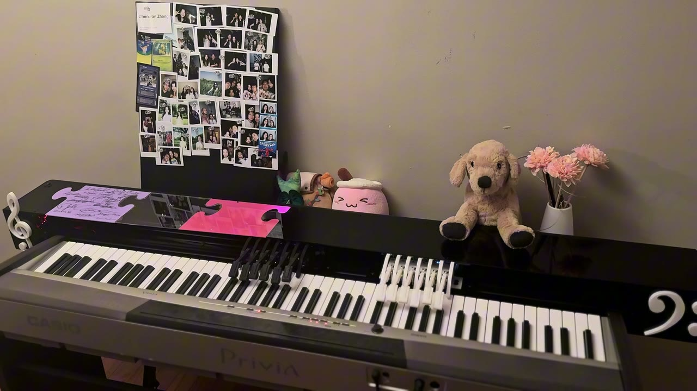
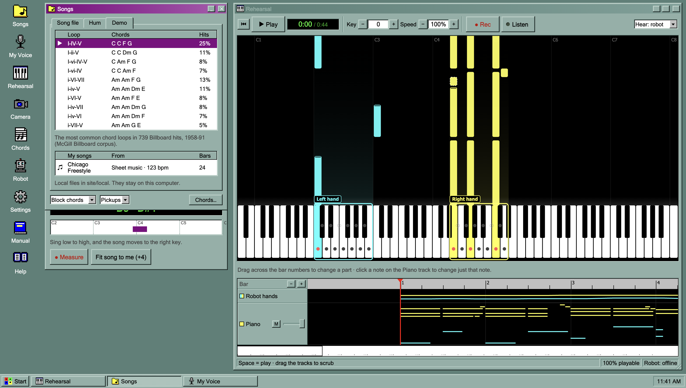

# Vocal2Piano

A robot piano accompanist. A singer sings, and a robot sitting on a real keyboard plays the piano part along with them.

The robot has two hands. Each hand is a carriage with 13 solenoid fingers (7 white-key, 6 black-key) that slides along the keyboard on a belt driven by a stepper motor. A web app prepares the song, plans every move and every key press, and sends them to the robot over USB while the song plays. Once a song is started, the robot runs on its own: the motors move the hands and the solenoids strike the keys.

[][youtube]

**Demo video:** [Vocal2Piano on YouTube][youtube] (also in the repository as [`media/Demo.mp4`](media/Demo.mp4))

**Design:** [Vocal2Piano on Figma][figma]

## How a song gets played



1. **Choose a song** in the web app: a MIDI file, sheet music (MusicXML), a tune hummed into the microphone, or a built-in chord loop.
2. **Adjust it** in the app: key, speed, piano style, chords, single bars and single notes. Every change can be heard on the computer's speakers straight away.
3. **The app plans the robot's playing**: where each hand has to be, which finger presses each key, when the hands move, and how hard each key is struck. It shows what share of the song the robot can play and lists anything it cannot.
4. **Connect and home the robot** in the app's Robot window, over USB.
5. **Press Play.** The app streams the plan to the robot a fraction of a second ahead of time. The firmware moves the carriages and fires the solenoids on time, and enforces its own safety limits.

With **Listen** on, the piano also follows the singer while it plays: it waits for each entrance, stops when the singing stops, matches the singer's loudness, and moves to the key being sung.

## System block diagram


| Block | What it does | Where |
|---|---|---|
| Song sources | Reads MIDI and MusicXML files, records humming, and offers chord loops from 739 Billboard hits | [`site/src/engine/score.ts`](site/src/engine/score.ts), [`midi.ts`](site/src/engine/midi.ts), [`musicxml.ts`](site/src/engine/musicxml.ts), [`humSession.ts`](site/src/humSession.ts) |
| Humming → chords | Tracks the hummed pitch, turns it into notes, finds the key, and picks chords with a model learned from pop songs | [`site/src/engine/harmonize.ts`](site/src/engine/harmonize.ts) |
| Arrangement | Turns chords into a piano part in one of five styles, and applies edits to bars and notes | [`site/src/engine/arranger.ts`](site/src/engine/arranger.ts), [`parts.ts`](site/src/engine/parts.ts) |
| Planner | Finds where the hands should be at every moment, assigns a finger to each note, and times every move and strike | [`site/src/engine/planner.ts`](site/src/engine/planner.ts), [`robot.ts`](site/src/engine/robot.ts) |
| Listen | Follows the singer through the microphone while playing | [`site/src/engine/listen.ts`](site/src/engine/listen.ts) |
| Scheduler and robot link | Plays the speakers and sends the robot's commands on one clock, 0.1–0.3 s ahead | [`site/src/audio.ts`](site/src/audio.ts), [`robotLink.ts`](site/src/robotLink.ts) |
| Firmware | Queues the timed commands, moves the carriages, fires the solenoids, and keeps the robot safe | [`firmware/`](firmware), protocol in [`firmware/PROTOCOL.md`](firmware/PROTOCOL.md) |
| C0nTrollER | Main board: power input and protection, 5 V supply, Teensy, two stepper drivers | [`hardware/PCB/`](hardware/PCB) |
| PLAyeRs | One board per hand: a PCA9685 and 13 MOSFET channels for the solenoids | [`hardware/PCB/`](hardware/PCB) |
| Mechanics | Carriages, fingers, mounts and enclosure | [`hardware/CAD/`](hardware/CAD) |

## Repository

| Folder | Contents |
|---|---|
| [`site/`](site) | The web app: React and TypeScript, runs in Chrome or Edge with nothing to install. It has a built-in manual (the **Manual** icon on its desktop) |
| [`firmware/`](firmware) | Teensy 4.1 firmware (PlatformIO), its serial protocol, and the robot bring-up steps |
| [`software/`](software) | Offline Python tools: statistics from music datasets, transcribers for local songs, and a player for a robot whose hands are moved by hand |
| [`hardware/CAD/`](hardware/CAD) | Fusion 360 models of the robot |
| [`hardware/PCB/`](hardware/PCB) | KiCad boards C0nTrollER and PLAyeRs, with fabrication files |
| [`media/`](media) | The demo video, its still, and the system block diagram |
| [`legacy/`](legacy) | The first version (Python pipeline, Max/MSP patch, old firmware), kept for reference |

## Quick start

The web app on a computer:

```bash
cd site
npm install
npm run dev      # opens on http://localhost:5173
```

The firmware on the Teensy, with [PlatformIO](https://platformio.org/):

```bash
cd firmware
pio run -t upload
```

Then, in the app: **Robot → Connect…**, **Home** (or **Set home here** on a robot without end stops), tick **Play on the real robot**, and **▶ Play** in **Rehearsal**. The app's **Manual** covers every step, and [`firmware/README.md`](firmware/README.md) covers the first power-up and calibration of a new robot.

## Safety

The firmware applies these limits whatever the app sends:

- no solenoid stays on longer than 2 s;
- no more than 4 A of solenoid current at once;
- the two hands always keep at least 5 free white keys between them;
- no move past either end of the keyboard;
- a closed page or a pulled USB cable stops everything.

## Local songs

Scores and recordings to transcribe go in `software/input/`, and the transcriptions in `site/local/`. Both folders are ignored by git and left out of the web deployment, because transcriptions of other people's songs are for private practice, not for publishing.

[youtube]: https://www.youtube.com/
[figma]: https://www.figma.com/
