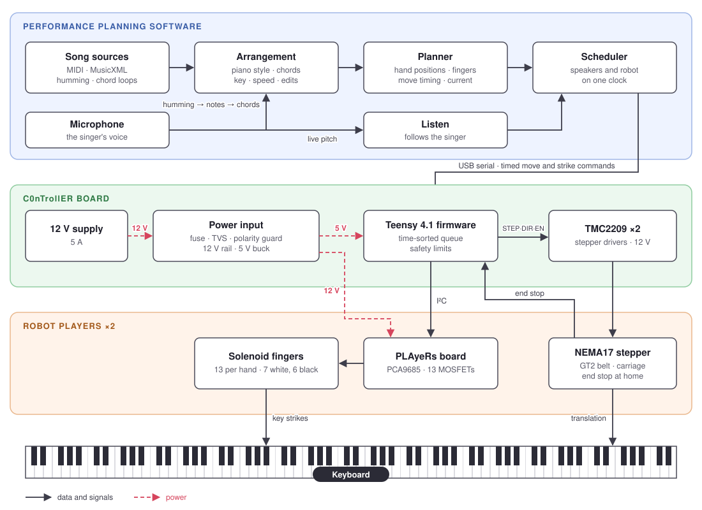

# Vocal2Piano: A voice-controlled robot piano accompanist.

An interactive robotic piano accompanist combining music processing, data-driven harmonization, motion planning, and real-time human-robot interaction.

<!-- [][figma] -->
[][live]
[][youtube]

https://github.com/user-attachments/assets/aacdaad4-1553-4352-8e96-a622a365c4c9

## Repo structure

| Folder | Contents |
|---|---|
| [`site/`](site) | The web app (React, TypeScript, Vite). Runs in Chrome or Edge with nothing to install, and has a built-in **Manual** |
| [`firmware/`](firmware) | Teensy 4.1 firmware (PlatformIO), the serial protocol, the safety rules and the bring-up steps for a new robot |
| [`software/`](software) | Offline Python tools: statistics from music datasets, transcribers for local songs, and a player for a robot whose carriages are moved by hand |
| [`hardware/PCB/`](hardware/PCB) | KiCad boards C0nTrollER and PLAyeRs, with fabrication files |
| [`hardware/CAD/`](hardware/CAD) | Fusion 360 models of the robot |
| [`legacy/`](legacy) | The first version (Python pipeline, Max/MSP patch, old firmware), kept for reference |

## How it works

The system has three layers. Software on a computer decides what to play and when, a controller board turns timed commands into motor steps and solenoid pulses, and two robot players on the keyboard move and strike the keys.

- **Web app** ([`site/`](site/README.md)). A browser app in React and TypeScript that runs in Chrome or Edge with nothing to install. It reads MIDI and MusicXML, or turns a hummed tune into notes, a key and chords with a hidden Markov model trained on pop songs. It arranges the chords into a piano part, and lets every bar and note be edited and heard on the speakers. A planner then fits the part to the robot: where each player should be at every moment, which finger strikes each key, when the players move, and how much solenoid current is drawn. During a performance it streams timestamped commands to the robot over Web Serial, and with Listen on it follows the singer through the microphone.

- **Firmware** ([`firmware/`](firmware/README.md)). Teensy 4.1 code that runs each command at its timestamp from a time-sorted queue. It steps both motors from a timer interrupt, shapes each solenoid strike (a velocity-controlled pulse, then a low-duty hold), and enforces the robot's safety limits on its own: hold time, total current, the gap between the players, end-stop checks, and a full stop when USB drops. The serial protocol is in [`PROTOCOL.md`](firmware/PROTOCOL.md).

- **Electronics** ([`hardware/PCB/`](hardware/PCB/README.md)). Two 4-layer KiCad boards. **C0nTrollER** takes 12 V through a fuse, TVS and reverse-polarity guard, makes 5 V with a buck converter, and carries the Teensy and two TMC2209 stepper drivers. **PLAyeRs**, one per player, drives 13 solenoids from a PCA9685 PWM chip through logic-level MOSFETs with flyback diodes and a status LED on every channel.

- **Mechanics** ([`hardware/CAD/`](hardware/CAD/README.md)). Fusion 360 design of two carriages that ride the length of the keyboard on GT2 belts driven by NEMA17 steppers. Each carriage holds 13 solenoid fingers, 7 for white keys and 6 for black keys, covering one octave, all inside an enclosure that sits on top of the keyboard.

- **Offline tools** ([`software/`](software/README.md)). Python scripts that build the harmonizer's statistics from the McGill Billboard and POP909 datasets, transcribe local songs, and play a song on a robot whose carriages are positioned by hand.

[youtube]:https://www.youtube.com/watch?v=shSAkz8AxsA&t=3s
[live]: https://vocal2piano.vercel.app
<!-- [figma]: https://www.figma.com/ -->
