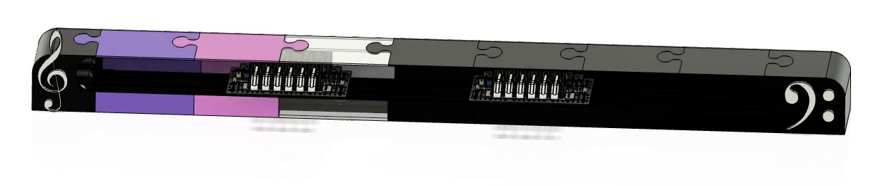

# CAD

Fusion 360 models of the robot: two carriages that ride along the keyboard on belts, each with 13 solenoid fingers, in an enclosure that sits on the keyboard. The full assembly is `PLAYeRob0T(assembled).step`, the enclosure `C0taINerr.step`, and the single parts are in `parts/`.

## Overview

| | |
|---|---|
| CAD software | Fusion 360 |
| Carriages | 2 (Treble + Bass) |
| Fingers per carriage | 13 (7 white + 6 black) |
| Actuator | JF-1039(B) push/pull solenoid × 26 |
| Carriage motion | NEMA17 stepper × 2 |
| Overall size (with enclosure) | 1676 × 215 × 123 mm (L × W × H) |

## Demo

Renders of the assembly. GitHub does not play videos stored in the repository inside a README, so each link opens the file.

| Full robot | Assembly sequence |
|---|---|
| [PLAYeRob0T.mp4](media/PLAYeRob0T.mp4) | [A$embLE.mp4](media/A%24embLE.mp4) |

| White-key finger (exploded) | Black-key finger (exploded) | Carriage (exploded) |
|---|---|---|
| |  | |
