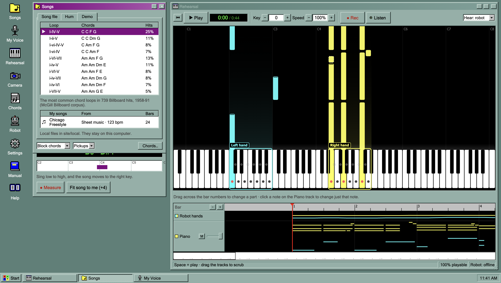

# Web app



The Vocal2Piano web app prepares a song, plans the robot's playing, and plays it on the real robot over USB. It runs in Chrome or Edge, which provide the microphone, the camera and the USB serial link (Web Serial). Nothing is installed on the computer.

## Run

```bash
cd site
npm install
npm run dev      # http://localhost:5173
npm run build    # static build in dist/, served as is by any static host (Vercel, GitHub Pages)
```

Shortcuts: `Space` play/pause · `Home` back to the start · `Delete` leave the selected note out · `Esc` clear the selection.

## From song to robot

1. **Songs**: a song is opened from a file, hummed, or picked from the demos.
2. **Rehearsal**, **Chords**, **My Voice**: the song is adjusted and heard on the speakers.
3. **Robot**: the playable share and the problems list show what the robot can play.
4. **Robot → Connect…**, then **Home** (or **Set home here**), then **Play on the real robot**.
5. **▶ Play** in Rehearsal: the hands travel to the song's start, and the song plays on the robot with no further input.

The **Manual** window on the app's desktop explains every window step by step.

## Windows

The app is a small retro desktop. Every feature is a window, opened from the desktop icons or the Start menu.

| Window | What it does |
|---|---|
| **Songs** | **Song file**: MIDI or sheet music (`.musicxml`, `.mxl`). Each part gets a role: *Me* (sung, left out of the robot's part), *Robot* or *Off*. A single-line part named like a vocal or a melody starts as *Me*; every other part starts as *Robot*. Taking the top line of the piano as the sung tune is a checkbox, off by default. **Hum**: four clicks count in, then the tune is hummed against the click. A lamp, a level meter and the note being heard show that the microphone picks up the voice, and the recording can be played back. **Done** writes down the notes, finds the key and picks chords for every half bar; a slider sets how closely the chords follow the tune. **Demo**: the most common chord loops in the McGill Billboard corpus, plus local MIDI files in `site/local/`. Piano style (block chords, broken chords, Alberti bass, stride, bossa nova) and extra notes for hummed tunes and demos |
| **Chords** | Any bar's chord and loudness; intro and rolled ending |
| **My Voice** | Measures the singer's comfortable range (kept in the browser) and suggests the key that fits it |
| **Rehearsal** | Play, key, speed, **● Rec** (records the singing), **👂 Listen** (the piano follows the voice, see below), and **Hear** (robot or original). A top view of the robot over the keyboard, and a timeline with tracks for the hands' positions, the piano, the sung tune (with the sung pitch on top) and the recording. Dragging the timeline scrubs; the strip below it jumps. **Changing one part**: dragging across the bar numbers selects bars, which then get their own speed, another piano style, or a cut (the ✂ on the ruler brings a cut bar back). **Changing one note**: a click on a note in the Piano track selects it, which can then be made shorter or longer (a quarter beat at a time) or left out (🔇 or Delete); left-out notes stay as grey dashed outlines, and a click brings one back |
| **How I Sang** | After a recording, or after singing with Listen on: notes in tune, notes sung, sharp or flat, early or late, and the lines worth practising |
| **Robot** | Playable share, peak solenoid current, and the problems list. **Connect** tab: USB link, **Home**, **Set home here**, **Release motors**, **Play on the real robot**, the robot's messages and the next step to take. **Save performance file…** writes the whole plan as JSON |
| **Camera** | A camera view at the same place and size as Rehearsal, for filming the robot and the app in one screen recording. **Rec** also saves the camera as a video file |
| **Manual** | The user guide: what each window does, the first song on the robot, and what to check when something goes wrong |
| **Settings** | Color scheme (after Windows 95's Desert, Standard, Eggplant, Rainy Day and Plum), which reactions 👂 Listen uses, the hand split, the most notes per hand, and octave folding |

## How it works

**Planner** (`src/engine/planner.ts`) turns an arrangement into something the robot can physically play:

1. Transpose and time-scale; group notes into onset slices; split the hands at the split point (C4 by default).
2. Thin chords down to the chosen number of notes per hand, keeping the outer notes.
3. **Viterbi search over carriage positions.** The right hand first, then the left hand, which always stays at least 12 white keys to its left (W1 to W1: the 7 keys of the left hand plus 5 free keys). The search minimizes missed notes and moves, and penalizes moves that cannot finish in time.
4. Give every note a finger on either hand, moving it by an octave when neither hand can reach it (an option).
5. Schedule moves as late as possible, and release fingers before a move, before striking the same key again, and after 2 s.
6. Check the solenoid current budget: full current for the first 300 ms of each strike, the hold duty after that.

**Playing on the robot** (`src/audio.ts`, `src/robotLink.ts`): one scheduler drives the speakers and the robot from the same clock. At ▶ Play it restarts the robot's clock (`STOP`, `ZERO`), sends both hands to where the song starts, and delays the start until they arrive. During the song it sends each move (`M`) and strike (`S`) 0.1–0.3 s before it is due, stamped with the time it should happen, so USB delays do not change the timing. After every stop, and after homing, the app reads the hands' positions back from the robot (`POS`), so the next start is timed from where the hands really are. The protocol is in [`firmware/PROTOCOL.md`](../firmware/PROTOCOL.md).

**Part changes** (`src/engine/parts.ts`) sit on top of the whole-song settings, bar by bar (a speed, a piano style, or a cut) and note by note (left out, or a new length). Each piano note gets an id from its start and pitch, which the robot plan keeps, so a block clicked on the timeline leads back to its note. The song is rebuilt with each bar moved to its new place and length, so the robot plan, the tune, the pitch check and the timeline all use the changed version. A new style for a chord chart re-plays those bars from the chart. For a written piano part, the bars' chords are first read from the notes (the major or minor triad that best covers each half bar, ties going to the song's key), then played in the new style.

**Listening** (`src/engine/listen.ts`): with 👂 Listen on, the microphone's pitch and level go to a listener 25 times a second, and the piano reacts like an accompanist would. It never follows the singer's tempo note by note; it only waits.

- **Waits for the entrance.** The tune is split into lines at rests of 1.5 beats or more. Nothing after the start of the next line is scheduled until the voice has been heard; with no voice 0.4 s after it, the piano stops and waits. When the singing starts it comes in together, from that line, or from the line before if that is the starting pitch.
- **Stops when the singer stops.** After 1.5 s (or 3 beats) of quiet where the tune should be sung, it stops. When the singing resumes it picks up from the note where it stopped, the start of that line, or the next line, whichever starts on the sung pitch. For the next 1.5 s it keeps comparing the singing with all three, and moves once if another one clearly fits better.
- **Plays as loud as the singing**, relative to the singer's usual level (0.65× to 1.3×), on the speakers and in the robot's strike strength.
- **Moves to the sung key.** When a whole line is sung a steady number of semitones away from the written key, the piano moves there in the rest after it.
- The sung pitch is drawn live on the *My tune* track, and **How I Sang** is built from it, with no recording needed. While ● Rec is on, the piano keeps time and does not wait, so the recording stays one continuous take.
- To tell the voice from the piano: a level well above the quietest of the last 3 s, a clear pitch, and, when that pitch is one the piano is sounding but not the one to be sung, it is taken as the piano. Headphones, or a microphone close to the singer, work best.

**Humming** (`src/humSession.ts`, `src/engine/harmonize.ts`): offline YIN pitch track → note segments (split on pitch changes, on sharp level drops, and on softer dips where the same note is hummed twice without a break) → tuning that follows the singer (it starts from the first notes and moves along, so slowly drifting flat or sharp does not change notes) → a note halfway between two is taken in the key of the tune → the singer's average lag behind the click taken out → eighth-note quantization → Krumhansl–Schmuckler key → a hidden Markov model over half bars, in the manner of MySong (CHI 2008): melody-over-chord and chord-transition probabilities from POP909, start and end chords from Billboard. On synthetic humming with loose timing, scoops, vibrato, ±22 cents per note and drift of up to 0.9 semitones, 87 % of notes come out right; most of the rest are repeated notes hummed without a dip. The sources of every number, and their accuracy, are in [`software/README.md`](../software/README.md).

The robot's geometry and limits are in `src/engine/robot.ts`. Carriage speed and acceleration match the firmware's limits in `firmware/src/config.h`, and the strike time and hold duty are sent to the robot with `CFG` when it connects.

## Layout

```
src/
├── engine/              runs in Node too (except musicxml.ts, which needs DOMParser)
│   ├── robot.ts         geometry, finger ↔ key, PCA9685 channel map, move timing
│   ├── planner.ts       playability planner
│   ├── arranger.ts      chord chart → piano part (5 named styles, passing and grace notes, dynamics, intro and ending)
│   ├── billboardStats.ts, melodyStats.ts   generated from Billboard and POP909 by software/*.py
│   ├── harmonize.ts     hummed audio → notes → key → chords
│   ├── listen.ts        the piano reacting to the voice as it plays
│   ├── parts.ts         per-part speed, style and cuts, per-note edits
│   ├── pitchCheck.ts    a recording, or what Listen heard, against the tune
│   ├── score.ts         imported parts, melody guess, top-line split
│   ├── midi.ts          MIDI import, performance file export
│   ├── musicxml.ts      MusicXML and .mxl import
│   ├── voice.ts         YIN pitch, vocal range, key suggestion
│   ├── audioAnalysis.ts beat, chord and key detection from audio (not used by the UI)
│   └── types.ts
├── components/          desktop and windows, Stage (top view), TrackView (timeline), pixel icons, Manual, Camera
├── audio.ts             piano, recordings and robot on one scheduler (waits for the singer, takes notes added live)
├── mic.ts               shared microphone: live pitch and raw capture
├── humSession.ts        humming against a click, with a level meter
├── robotLink.ts         Web Serial link to the Teensy
└── App.tsx
public/                  tab icon (pixel gear and note)
media/                   screenshot for this README (not part of the build)
```

## Known limits

- Part changes count bars in 4/4 at the song's first tempo, and a recording made before a part change does not move with it.
- Repeats and voltas in sheet music are not expanded.
- Listen has been measured with a synthetic voice fed in as the microphone.
- The local songs under *My songs* only appear when the app runs from this folder; the web deployment leaves `local/` out.
